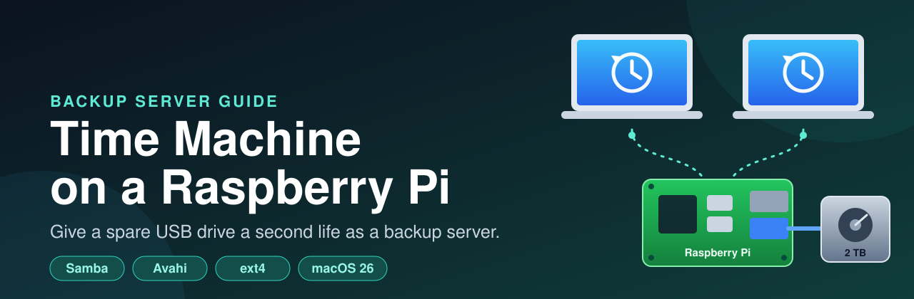

<p align="center">
  
</p>

<p align="center">
  
  
  
  
  
</p>

<h1 align="center">Time Machine on a Raspberry Pi</h1>

<p align="center"><b>Turn an old USB hard drive and a Raspberry Pi into a Time Machine backup server for your Macs.<br>No new hardware, and no old drive left on the shelf.</b></p>

This guide was built and tested on a Raspberry Pi 4 with a 2 TB WD Red drive that had been retired from an old NAS. Everything here is either a command you can paste or a script you can run, and every step says why it is there.

> [!CAUTION]
> Step 2 **erases the disk**. Copy anything you want to keep before you start.

## ✨ What you end up with

<p align="center"></p>

<p align="center"></p>

## 🧰 What you need

| | Item | Notes |
|---|---|---|
| 🍓 | **A Raspberry Pi** | Tested on a Pi 4 Model B. A Pi 3 works but is slower; a Pi 5 is faster. |
| 💾 | **A USB hard drive** | Any size. A 2.5" drive can run from the Pi's USB power; a 3.5" drive needs its own power supply. |
| 🔌 | **An Ethernet cable** | Wired is strongly recommended for the Pi. The first backup is large. |
| 💳 | **A microSD card** | For Raspberry Pi OS. Debian 13 "trixie" was tested. |
| 💻 | **A Mac on macOS 11 (Big Sur) or later** | Tested with macOS 26 (Tahoe). |

## 🗺️ The route

<p align="center"></p>

## ⚡ The quick version

On the Pi, once the OS is installed and you can reach it over SSH:

```bash
sudo apt-get install -y git
git clone https://github.com/yrafique/raspberry-pi-time-machine.git timemachine-pi && cd timemachine-pi
cp config.env.example config.env && nano config.env     # choose your disk and one name per Mac
sudo ./scripts/setup-all.sh                              # installs, ERASES the disk, configures, checks
```

Then on each Mac: **System Settings → General → Time Machine → Add Backup Disk**. The details are in [chapter 5](docs/05-connect-your-macs.md).

## 📖 The book

Read it in order the first time. Each chapter ends with a link to the next.

| | Chapter | What it covers |
|---|---|---|
| 🧠 | [1. How it works](docs/01-how-it-works.md) | The pieces, why Samba, and what to expect |
| 🍓 | [2. Prepare the Pi](docs/02-prepare-the-pi.md) | The OS, SSH, a fixed address, updates |
| 💾 | [3. Prepare the drive](docs/03-prepare-the-drive.md) | Find, erase, format and mount the disk |
| ⚙️ | [4. Install the server](docs/04-install-the-server.md) | Packages, Samba, Bonjour, users and shares |
| 💻 | [5. Connect your Macs](docs/05-connect-your-macs.md) | Add the disk, the first backup, restoring |
| 🛡️ | [6. Make it survive reboots](docs/06-persistence-and-hardening.md) | Boot order, disk health, a reboot test |
| 🚀 | [7. Speed](docs/07-performance.md) | What we measured, and how to measure yours |
| 🩺 | [8. Troubleshooting](docs/08-troubleshooting.md) | The macOS 26 Samba bug, managed work laptops, every error we hit |
| 🧹 | [9. Maintenance](docs/09-maintenance.md) | Updates, adding or removing a Mac, health checks |

## 🗂️ What is in this repository

```
.
├── README.md                    this page
├── requirements-apt.txt         every package that gets installed, and why
├── config.env.example           your settings: disk, mount point, one name per Mac
├── scripts/
│   ├── setup-all.sh             runs steps 1 to 4, then verify
│   ├── 01-install-packages.sh   installs requirements-apt.txt
│   ├── 02-prepare-drive.sh      ERASES the disk, partitions, formats, mounts at boot
│   ├── 03-configure-shares.sh   users, folders, Samba shares, Bonjour
│   ├── 04-harden.sh             start order, boot at startup, SMART monitoring
│   ├── add-mac.sh               add another Mac later
│   ├── remove-mac.sh            remove a Mac's share
│   ├── verify.sh                read-only health check
│   └── benchmark.sh             measures the drive's raw speed
├── config/mac/nsmb.conf         optional Mac-side workaround, see chapter 8
├── tools/diagrams/              the Python that draws every illustration (python3 build.py)
└── docs/                        the chapters and their images
```

## ✅ What was tested

| | |
|---|---|
| 🍓 Hardware | Raspberry Pi 4 Model B, WD Red 2 TB (WD20EFRX) in a USB 3.0 enclosure, gigabit Ethernet |
| 🐧 OS | Debian GNU/Linux 13 (trixie), 64-bit, kernel 6.18 |
| 🗂️ Server | Samba 4.22.11 from the Debian repository |
| 💻 Client | macOS 26 (Tahoe) over SMB 3.1.1 |

The scripts were run against that system. Step 2 (erasing a disk) was done by hand with the same commands the script uses, so if you hit a problem in a script, please [open an issue](https://github.com/yrafique/raspberry-pi-time-machine/issues).

## 🤔 Why not just buy a NAS?

You can, and that is a fine answer. This is for when you already own a spare Pi and a drive, you want to keep them out of the landfill, and you don't mind learning a little along the way.

## 📄 License

[MIT](LICENSE). Use it, copy it, change it, share it.
