🏠 <a href="../README.md">Home</a> &nbsp;·&nbsp; <b>Chapter 1 of 9</b> &nbsp;·&nbsp; ▰▱▱▱▱▱▱▱▱ &nbsp;·&nbsp; <a href="02-prepare-the-pi.md">Next: Prepare the Pi →</a>

# 🧠 1. How it works

Time Machine can back up to a disk plugged into your Mac, or to a **network share**. A network share is a folder that your Mac reaches over your home network. The Raspberry Pi hosts that folder, and the USB drive gives it room to grow.

## 🧩 The big picture

## 🔧 The three pieces

| | Piece | What it does | Package |
|---|---|---|---|
| 🗂️ | **Samba** | Shares folders using SMB, the protocol Macs use for file sharing. Its `vfs_fruit` module adds the Apple extensions that Time Machine requires. | `samba` |
| 🔎 | **Avahi** | Announces the share over Bonjour, so your Mac lists it in Time Machine without you typing an address. | `avahi-daemon` |
| 💾 | **An ext4 disk** | An ordinary Linux filesystem. Time Machine stores its data in a disk image (a *sparsebundle*), so the disk doesn't need an Apple format. | `parted`, `e2fsprogs` |

> [!NOTE]
> **Why SMB and Samba?** Apple removed the older AFP protocol, and Time Machine over SMB is now the supported route for network backups. Samba has supported it since version 4.8, through `fruit:time machine = yes`. Other routes exist, such as a dedicated NAS operating system or a Docker image, but they hide the details. This guide uses plain Samba so that you can see and change every part.

## 🔁 What happens during a backup

## 👥 Why one share per Mac?

Each Mac creates its own backup file inside the share, so two Macs could safely share one folder. A separate share and login for each Mac gives you three things:

Neither login works on the other Mac's share. A Mac that tries is refused.

1. 🔒 One Mac can't read or delete another Mac's backups.
2. 🏢 A work laptop and a personal laptop stay separate. This matters if the work laptop's policy allows backups at all (see [chapter 8](08-troubleshooting.md#managed-laptops)).
3. 🧹 You can remove one Mac cleanly later.

## ⚖️ Why no quotas?

All Macs share the whole disk. Time Machine deletes a Mac's oldest backups when space runs low, so each Mac manages itself. The catch is that one Mac that backs up far more data can crowd out the others.

> [!TIP]
> If that worries you, set a limit per share with `fruit:time machine max size = 900G` in the share block.

## 🕰️ What to expect

- 🐢 **First backup:** slow. It copies everything. Plan for hours (see [chapter 7](07-performance.md)).
- 🐇 **After that:** hourly incremental backups, usually a minute or two each.
- 📦 **Disk space:** the first backup is roughly the size of the data on your Mac. Older backups are removed as space runs low.
- 🔌 **The Pi must be on** when your Mac wants to back up. If it is off, the Mac skips that backup and tries again later.

## ⚠️ Where this can go wrong

| Risk | How this guide handles it |
|---|---|
| 💥 The disk dies | The disk is monitored with SMART ([chapter 6](06-persistence-and-hardening.md)). A backup disk is a second copy, not the only copy, so keep that in mind for irreplaceable files. |
| 🐛 A Samba update breaks Time Machine | See the macOS 26 bug in [chapter 8](08-troubleshooting.md#samba-bug). `verify.sh` checks your version. |
| ⚡ The Pi reboots before the disk is ready | Samba is told to wait for the disk to mount ([chapter 6](06-persistence-and-hardening.md)). |
| 👀 Someone on your network reads your backups | Each share needs its own username and password, and the folders are private to their user. Backups aren't encrypted by default. Turn on encryption in Time Machine if the Pi is in a shared space ([chapter 5](05-connect-your-macs.md)). |

---

🏠 <a href="../README.md">Home</a> &nbsp;·&nbsp; <b>Chapter 1 of 9</b> &nbsp;·&nbsp; <a href="02-prepare-the-pi.md">Next: Prepare the Pi →</a>

