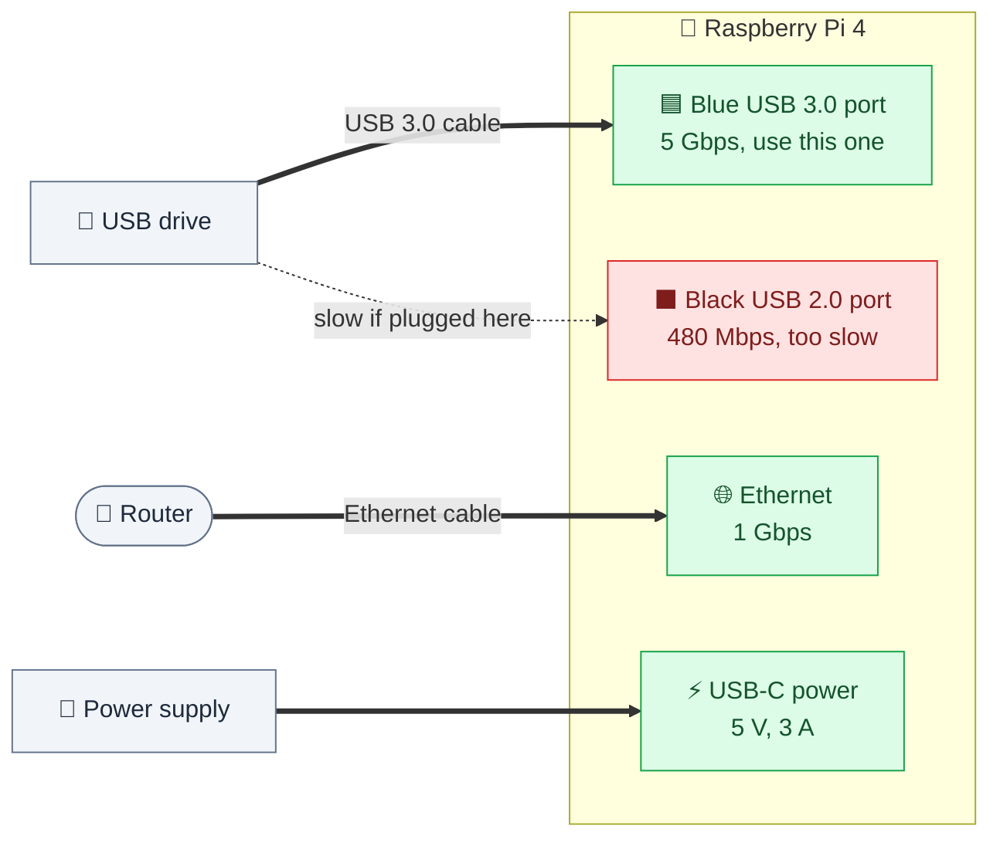

<p align="center"><sub><a href="01-how-it-works.md">← Previous</a> &nbsp;·&nbsp; 🏠 <a href="../README.md">Home</a> &nbsp;·&nbsp; <b>Chapter 2 of 9</b> &nbsp;·&nbsp; ▰▰▱▱▱▱▱▱▱ &nbsp;·&nbsp; <a href="03-prepare-the-drive.md">Next: Prepare the drive →</a></sub></p>

# 🍓 2. Prepare the Pi

If your Pi already runs Raspberry Pi OS and you can SSH in, skim this chapter for the network advice and move on.


## 💳 2.1 Install the operating system

1. Download **Raspberry Pi Imager** from raspberrypi.com and open it.
2. Choose your Pi model, then **Raspberry Pi OS Lite (64-bit)**. The desktop isn't needed. This guide was tested on Debian 13 "trixie".
3. Before writing, open the settings (the gear, or "Edit settings") and set:
   - a **hostname**, for example `timemachine`, so your Macs will reach it as `timemachine.local`
   - a **username and password**
   - **Enable SSH**
   - your **Wi-Fi details**, only if you can't use Ethernet
4. Write the card, put it in the Pi, connect the **Ethernet cable**, and power on.

## 🔑 2.2 Connect over SSH

From your Mac's Terminal:

```bash
ssh <your-user>@timemachine.local
```

If `.local` doesn't resolve, find the Pi's address in your router's device list and use that.

## 📌 2.3 Give the Pi a fixed address

Your Macs find the Pi by name, but a fixed address makes troubleshooting much easier, and lets you connect by IP if name lookup ever fails.

> [!TIP]
> The cleanest way is a **DHCP reservation** in your router. Find the Pi in the router's device list and reserve its current address for it. Doing this on the router means there is nothing on the Pi to maintain.

Write the address down. This guide calls it `<pi-address>`.

## ⬆️ 2.4 Update everything

```bash
sudo apt-get update
sudo apt-get -y full-upgrade
```

Reboot if it tells you to:

```bash
ls /var/run/reboot-required 2>/dev/null && sudo reboot
```

> [!NOTE]
> On a slow SD card you may see `Error: Timeout was reached` near the end of an upgrade. If `sudo dpkg --audit` prints nothing and `apt list --upgradable` is empty, everything installed correctly.

## 🔌 2.5 Check the hardware

Connect the USB drive, then look for it:

```bash
lsblk -o NAME,SIZE,MODEL,TRAN,FSTYPE,LABEL,MOUNTPOINT
```

You should see it as `sda` (or similar), with `usb` under `TRAN`. This is the output from the tested system:

```
NAME         SIZE MODEL                TRAN
sda          1.8T WDC WD20EFRX-68EUZN0 usb
mmcblk0     14.7G                      mmc
├─mmcblk0p1  512M
└─mmcblk0p2 14.2G
```

> [!WARNING]
> `mmcblk0` is the Pi's own SD card. **Never** erase that one.



Check that the drive connected at full speed. A USB 3.0 port shows `5000M`:

```bash
lsusb -t
```

Look for your drive under the `5000M` root hub with `Driver=uas`. If it says `480M`, it's on a USB 2.0 port or cable, which is far slower. The Pi 4's **blue** ports are USB 3.0.

> [!IMPORTANT]
> **Power.** A 3.5" drive needs its own power adapter. A 2.5" drive usually runs from the Pi's USB port, but if the drive keeps disconnecting, use a powered USB hub or a stronger Pi power supply.

## 📥 2.6 Get this repository onto the Pi

```bash
sudo apt-get install -y git
git clone https://github.com/yrafique/raspberry-pi-time-machine.git timemachine-pi
cd timemachine-pi
cp config.env.example config.env
nano config.env
```

Set `DISK` to the device you found (for example `/dev/sda`) and `USERS` to one name per Mac (for example `"personal work"`). Everything else can stay as it is.

---

<p align="center"><sub><a href="01-how-it-works.md">← Previous</a> &nbsp;·&nbsp; 🏠 <a href="../README.md">Home</a> &nbsp;·&nbsp; <b>Chapter 2 of 9</b> &nbsp;·&nbsp; <a href="03-prepare-the-drive.md">Next: Prepare the drive →</a></sub></p>
