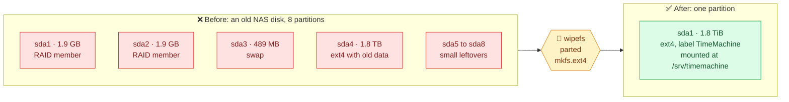
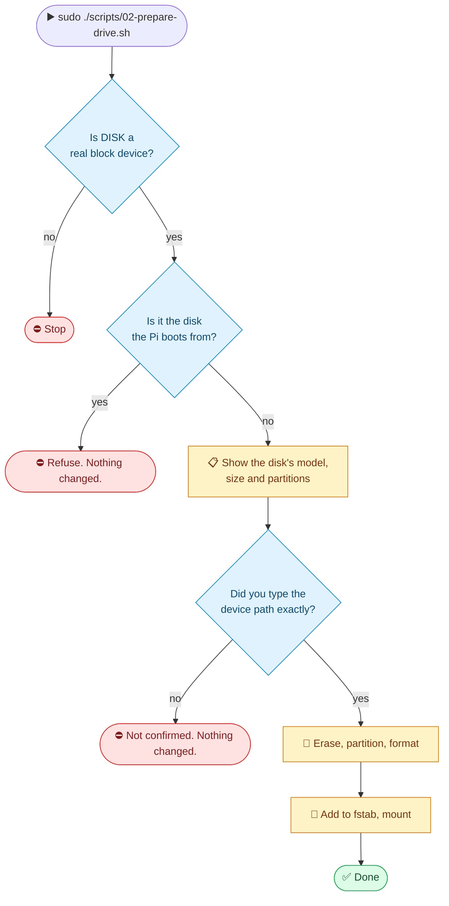

<p align="center"><sub><a href="02-prepare-the-pi.md">← Previous</a> &nbsp;·&nbsp; 🏠 <a href="../README.md">Home</a> &nbsp;·&nbsp; <b>Chapter 3 of 9</b> &nbsp;·&nbsp; ▰▰▰▱▱▱▱▱▱ &nbsp;·&nbsp; <a href="04-install-the-server.md">Next: Install the server →</a></sub></p>

# 💾 3. Prepare the drive

> [!CAUTION]
> **This erases the disk.** Everything on it is destroyed. Look at what is on it first (section 3.1), and copy anything you want to keep to another machine before you continue.

**The easy way:** after step 1 of [chapter 4](04-install-the-server.md), run `sudo ./scripts/02-prepare-drive.sh`. It makes the same changes as below, refuses to touch the disk the Pi boots from, and makes you type the device name before it erases anything. The rest of this chapter explains what it does.

## 👀 3.1 Look before you erase

Our example disk came out of an old NAS. It had eight partitions, including Linux RAID members and swap, and it was 93% full. Looking first showed what it held (an old Time Machine backup and a personal folder), and told us exactly what we were about to destroy.

To look at a disk's contents without changing anything, mount it read-only:

```bash
sudo mkdir -p /mnt/peek
sudo mount -o ro /dev/sda4 /mnt/peek      # use the big data partition shown by lsblk
sudo du -h --max-depth=2 /mnt/peek | sort -h | tail -15
sudo umount /mnt/peek
```

If the data partition isn't ext4 (for example NTFS or exFAT from a Windows disk), the mount may need `-t ntfs-3g` or similar. Or plug the disk into the computer it came from.

## 🔄 3.2 Before and after



## 🛡️ 3.3 How the script protects you



| Step | Command | Why |
|---|---|---|
| 🧽 Unmount and clear signatures | `umount`, `swapoff`, `wipefs -a` | Old filesystems and RAID labels can confuse the system later. |
| 🗺️ New partition table | `parted -s /dev/sda mklabel gpt mkpart TimeMachine ext4 1MiB 100%` | One partition using the whole disk. GPT works for any size. |
| 📀 Format | `mkfs.ext4 -L TimeMachine -m 0 /dev/sda1` | `-L` sets the label. `-m 0` reserves no space for root. The default 5% would waste about 100 GB on a 2 TB data disk. |
| 📌 Mount by UUID | an `/etc/fstab` line | Device names like `/dev/sda` can change between boots. The UUID doesn't. |

> [!NOTE]
> **Why ext4?** Time Machine writes a disk image (a sparsebundle) onto the share, so the filesystem underneath only has to be reliable. ext4 is mature and native to Linux. You don't need to format the disk as APFS or HFS+, and Linux can't write those reliably anyway.

### 🔬 The fstab line, piece by piece

```
UUID=ec3b70b7-…  /srv/timemachine  ext4  defaults,noatime,nofail,x-systemd.device-timeout=30  0  2
└──────┬───────┘ └───────┬───────┘ └─┬─┘ └────────────────────────┬─────────────────────────┘ └┬┘
   which disk       where it goes   type                     options                         fsck order
```

| Option | Meaning |
|---|---|
| `noatime` | Don't write a "last read" time on every read. Less wear, and a little faster. |
| `nofail` | **Important.** If the disk is missing at boot, carry on starting instead of dropping into emergency mode. |
| `x-systemd.device-timeout=30` | Wait at most 30 seconds for the disk to appear. |

## ⌨️ 3.4 Doing it by hand

<details>
<summary><b>Show the manual commands</b> (the script runs these for you)</summary>

Replace `/dev/sda` with your disk:

```bash
# 1. Triple-check the target
lsblk -o NAME,SIZE,MODEL,TRAN /dev/sda

# 2. Unmount anything on it and wipe old signatures
for p in $(lsblk -nrpo NAME /dev/sda | tail -n +2); do sudo umount $p 2>/dev/null; sudo swapoff $p 2>/dev/null; sudo wipefs -a $p; done
sudo wipefs -a /dev/sda

# 3. Partition and format
sudo parted -s /dev/sda mklabel gpt mkpart TimeMachine ext4 1MiB 100%
sudo mkfs.ext4 -L TimeMachine -m 0 /dev/sda1

# 4. Mount permanently
sudo mkdir -p /srv/timemachine
UUID=$(sudo blkid -s UUID -o value /dev/sda1)
echo "UUID=$UUID /srv/timemachine ext4 defaults,noatime,nofail,x-systemd.device-timeout=30 0 2" | sudo tee -a /etc/fstab
sudo systemctl daemon-reload
sudo mount /srv/timemachine
df -h /srv/timemachine
```

</details>

You should see about **1.8T** total for a "2 TB" disk. Manufacturers count in powers of ten (2,000,000,000,000 bytes), while the system counts in powers of two (1.82 TiB), so the same disk looks smaller.

## 🔎 3.5 Check the result

```bash
lsblk -o NAME,SIZE,FSTYPE,LABEL,UUID /dev/sda
df -h /srv/timemachine
findmnt --verify
```

`findmnt --verify` should say `Success, no errors or warnings detected`.

---

<p align="center"><sub><a href="02-prepare-the-pi.md">← Previous</a> &nbsp;·&nbsp; 🏠 <a href="../README.md">Home</a> &nbsp;·&nbsp; <b>Chapter 3 of 9</b> &nbsp;·&nbsp; <a href="04-install-the-server.md">Next: Install the server →</a></sub></p>
