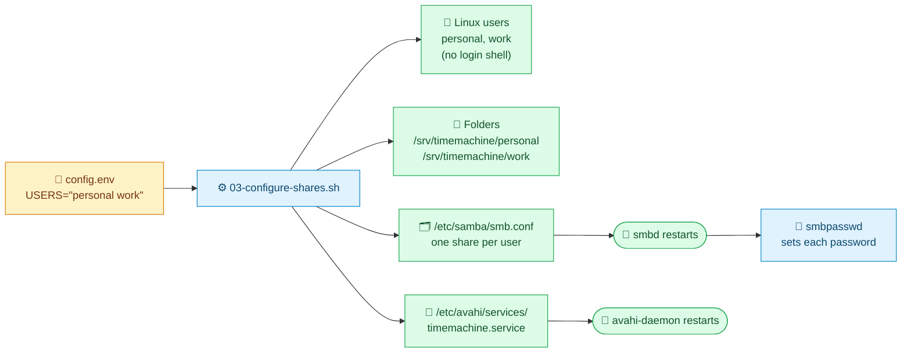
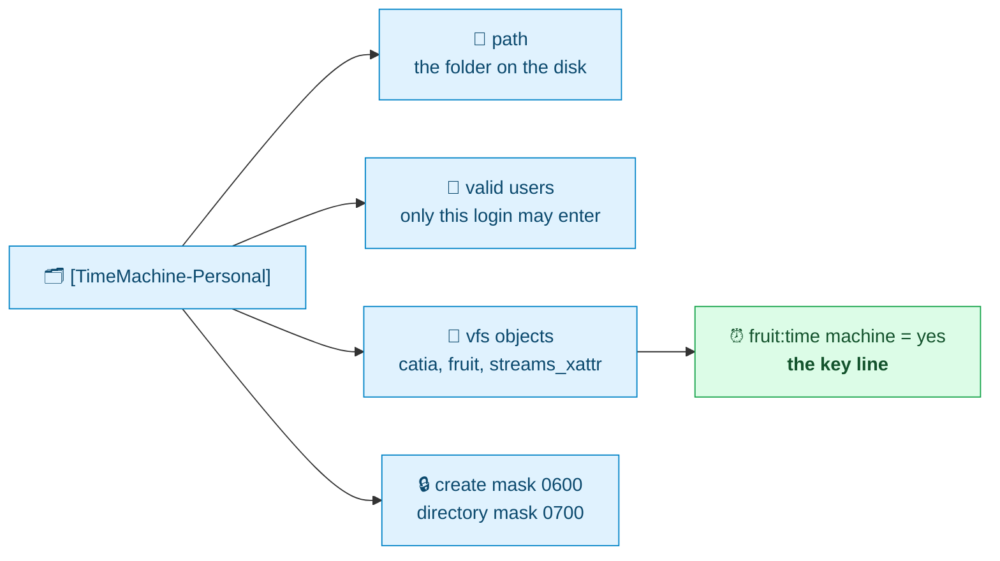

<p align="center"><sub><a href="03-prepare-the-drive.md">← Previous</a> &nbsp;·&nbsp; 🏠 <a href="../README.md">Home</a> &nbsp;·&nbsp; <b>Chapter 4 of 9</b> &nbsp;·&nbsp; ▰▰▰▰▱▱▱▱▱ &nbsp;·&nbsp; <a href="05-connect-your-macs.md">Next: Connect your Macs →</a></sub></p>

# ⚙️ 4. Install and configure the server

This chapter installs the software, then creates one Samba login and one share per Mac.

**The easy way:**

```bash
sudo ./scripts/01-install-packages.sh      # section 4.1
sudo ./scripts/03-configure-shares.sh      # sections 4.2 to 4.5
```

Step 2, the drive, comes between them. Or run everything with `sudo ./scripts/setup-all.sh`. The rest of the chapter shows what those scripts do, so you can understand it or do it by hand.

## 🧭 What the scripts build



## 📦 4.1 Install the packages

The complete list lives in [`requirements-apt.txt`](../requirements-apt.txt):

| | Package | Purpose | Required? |
|---|---|---|---|
| 🗂️ | `samba` | the file server | ✅ yes |
| 🔎 | `avahi-daemon` | Bonjour announcements | ✅ yes |
| 🧮 | `parted` | partitioning | ✅ yes |
| 📀 | `e2fsprogs` | formatting ext4 | ✅ yes (usually preinstalled) |
| ❤️‍🩹 | `smartmontools` | disk health | 👍 recommended |
| 🔍 | `smbclient` | test the shares from the Pi | 👍 recommended |
| 🧾 | `libxml2-utils` | validate the Bonjour file | 👍 recommended |
| 📡 | `tcpdump` | check whether traffic arrives | ➕ optional |

By hand:

```bash
sudo apt-get update
sudo apt-get install -y samba avahi-daemon parted e2fsprogs smartmontools smbclient libxml2-utils tcpdump
```

### 🔢 Check the Samba version

```bash
smbd --version
```

> [!IMPORTANT]
> **You need Samba 4.22.6 or newer.** Samba 4.21 and the early 4.22 releases have a bug that breaks Time Machine on macOS 26. Debian 13 ships 4.22.11, which is fine. Details are in [chapter 8](08-troubleshooting.md#samba-bug).

| Samba version | macOS 26 Time Machine |
|---|---|
| 4.20 and older | 🟢 works |
| 4.21.x | 🔴 broken |
| 4.22.0 to 4.22.5 | 🔴 broken |
| **4.22.6 and newer** | 🟢 works |

## 👤 4.2 Create a user and a folder for each Mac

Each Mac gets a Linux user that can't log in (it exists only to own files) and a private folder:

```bash
sudo useradd -M -s /usr/sbin/nologin personal
sudo install -d -o personal -g personal -m 700 /srv/timemachine/personal
```

`-M` means no home directory, and `/usr/sbin/nologin` means the account can't open a shell or use SSH. Mode `700` means only that user can open the folder. Repeat for each Mac.

## 🗂️ 4.3 Configure the Samba share

Samba's configuration file is `/etc/samba/smb.conf`. First keep a copy of the original:

```bash
sudo cp -n /etc/samba/smb.conf /etc/samba/smb.conf.orig
```

Then **delete** the default `[homes]`, `[printers]` and `[print$]` sections, which a backup server doesn't need and which would expose home folders, and **append** this for each Mac:

```ini
[global]
   fruit:aapl = yes

[TimeMachine-Personal]
   path = /srv/timemachine/personal
   valid users = personal
   read only = no
   vfs objects = catia fruit streams_xattr
   fruit:time machine = yes
   fruit:metadata = stream
   fruit:model = MacSamba
   fruit:posix_rename = yes
   fruit:veto_appledouble = no
   fruit:nfs_aces = no
   fruit:wipe_intentionally_left_blank_rfork = yes
   fruit:delete_empty_adfiles = yes
   create mask = 0600
   directory mask = 0700
```



| Setting | Meaning |
|---|---|
| `path` | The folder on the disk. |
| `valid users` | Only this login can open the share. |
| `vfs objects = catia fruit streams_xattr` | Load the Apple compatibility modules. `streams_xattr` stores Mac metadata in extended attributes. |
| `fruit:time machine = yes` | **The key line.** Tells Macs this share is a Time Machine destination. |
| `fruit:aapl = yes` | Enables Apple's SMB extensions for all shares. A second `[global]` section is allowed; Samba merges them. |
| `fruit:metadata`, `fruit:model`, `fruit:posix_rename`, `fruit:veto_appledouble`, `fruit:nfs_aces`, `fruit:wipe_...`, `fruit:delete_...` | Standard Mac-compatibility settings from the Samba wiki and Tahoe-era guides. |
| `create mask`, `directory mask` | New files and folders are private to the owner. |

Check the file and see what Samba understood:

```bash
testparm -s | grep -E '^\[|Loaded'
```

The output should include `Loaded services file OK` and one line per share.

> [!TIP]
> **Optional quota.** To stop one Mac from using more than its share of space, add `fruit:time machine max size = 900G` to its share block. Leave it out to let each Mac use whatever it needs.

## 🔑 4.4 Set each Mac's password

```bash
sudo smbpasswd -a personal
```

It asks for the password twice. The password is for the Samba login only, separate from the Pi's own users.

> [!WARNING]
> Pick a strong password. Anyone on your network who has it can read that Mac's backups.

## 📣 4.5 Announce the shares with Bonjour

Create `/etc/avahi/services/timemachine.service`:

```xml
<?xml version="1.0" standalone="no"?>
<!DOCTYPE service-group SYSTEM "avahi-service.dtd">
<service-group>
  <name replace-wildcards="yes">%h</name>
  <service><type>_smb._tcp</type><port>445</port></service>
  <service>
    <type>_adisk._tcp</type>
    <txt-record>sys=waMa=0,adVF=0x100</txt-record>
    <txt-record>dk0=adVN=TimeMachine-Personal,adVF=0x82</txt-record>
    <txt-record>dk1=adVN=TimeMachine-Work,adVF=0x82</txt-record>
  </service>
  <service><type>_device-info._tcp</type><port>0</port><txt-record>model=TimeCapsule8,119</txt-record></service>
</service-group>
```

| Record | What it tells the Mac |
|---|---|
| 🖥️ `_smb._tcp` | "There is a file server here." |
| ⏰ `_adisk._tcp` | "This is a disk that can hold backups." Add one `dkN=adVN=<share name>,adVF=0x82` line per share, numbered `dk0`, `dk1` and so on. This is what puts the share in Time Machine's list. |
| 🕰️ `_device-info._tcp` | Makes the Pi appear with a Time Capsule icon in Finder. |

Check that the file is valid XML:

```bash
xmllint --noout /etc/avahi/services/timemachine.service && echo OK
```

## ▶️ 4.6 Start everything

```bash
sudo systemctl enable --now smbd avahi-daemon
sudo systemctl restart smbd avahi-daemon
systemctl is-active smbd avahi-daemon
```

Both should print `active`. Test that a login works, without involving a Mac:

```bash
smbclient -L localhost -U personal
```

Enter the password. You should see `TimeMachine-Personal  Disk` in the list.

> [!WARNING]
> **Restarting Samba interrupts a running backup.** The Mac reconnects by itself, but the backup in progress stops. Change shares between backups where you can.

---

<p align="center"><sub><a href="03-prepare-the-drive.md">← Previous</a> &nbsp;·&nbsp; 🏠 <a href="../README.md">Home</a> &nbsp;·&nbsp; <b>Chapter 4 of 9</b> &nbsp;·&nbsp; <a href="05-connect-your-macs.md">Next: Connect your Macs →</a></sub></p>
