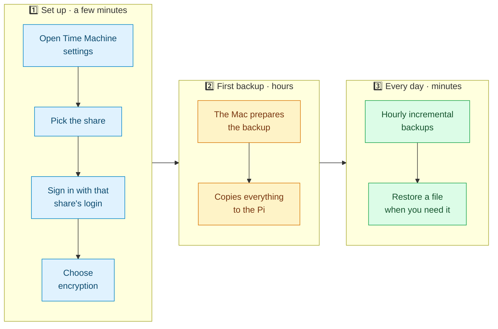
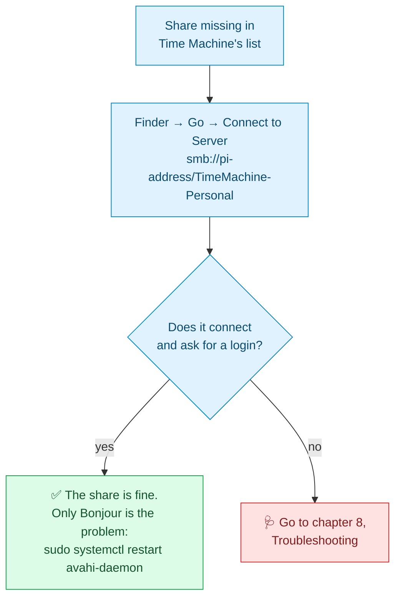
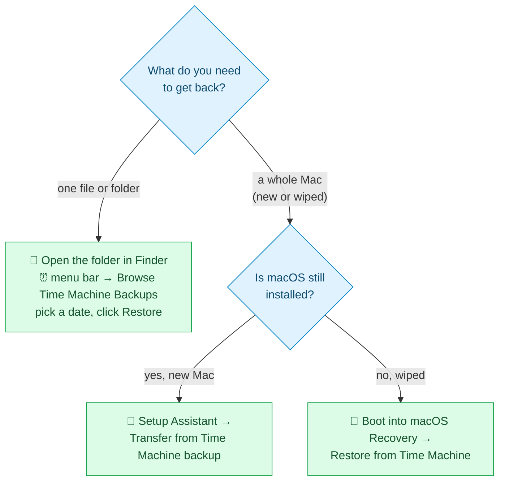

<p align="center"><sub><a href="04-install-the-server.md">← Previous</a> &nbsp;·&nbsp; 🏠 <a href="../README.md">Home</a> &nbsp;·&nbsp; <b>Chapter 5 of 9</b> &nbsp;·&nbsp; ▰▰▰▰▰▱▱▱▱ &nbsp;·&nbsp; <a href="06-persistence-and-hardening.md">Next: Make it survive reboots →</a></sub></p>

# 💻 5. Connect your Macs



## ➕ 5.1 Add the backup disk

On each Mac:

1. Open **System Settings → General → Time Machine**.
2. Click **Add Backup Disk** (the **+** button).
3. Choose your share, for example `TimeMachine-Personal`.
4. Click **Set Up Disk**.
5. Sign in with that share's **username** (`personal`) and the **password** you set with `smbpasswd`. Use the matching pair for each Mac. A Mac that tries another Mac's login is refused.
6. Decide on **encryption**.

> [!TIP]
> Turning on **Encrypt Backup** is a good idea if the Pi is in a shared space, because backups are readable on the Pi's disk otherwise. Keep the password somewhere safe: a lost password means the backup can't be read.

The Mac starts the first backup right away.

### 🔍 If the share doesn't appear in the list

Time Machine only lists shares that Bonjour announces. Try connecting directly first:



You can also add the disk from Terminal:

```bash
sudo tmutil setdestination -a "smb://personal@<pi-address>/TimeMachine-Personal"
```

It asks for the password.

## 🐢 5.2 The first backup

Expect it to take a long time. The first backup copies everything, and the network is the limit, not the disk. A rough guide from our tests (see [chapter 7](07-performance.md)):

| Connection | Roughly how long for 500 GB |
|---|---|
| 🔌 Wired gigabit | 3 to 5 hours |
| 📶 Wi-Fi | 9 hours or more |

Tips for the first run:

- 🔋 Plug the Mac in and keep it awake. A sleeping Mac pauses the backup. It resumes by itself when the Mac wakes, but the backup then takes longer overall.
- 🔌 Put the Mac on **wired Ethernet** for the first backup if you can. A USB-C Ethernet adapter is enough.
- 🚫 Don't restart the Pi or Samba during the first backup.

You can watch progress in System Settings → General → Time Machine, or from the Pi:

```bash
sudo du -sh /srv/timemachine/*          # the folder grows as data arrives
sudo smbstatus -b                       # who is connected right now
```

> [!NOTE]
> An empty folder for the first few minutes is normal. Time Machine spends that time "preparing" before it creates its backup file.

When it finishes, there is a file named like `<Your Mac's name>.sparsebundle` in the share's folder on the Pi.

## 🐇 5.3 Later backups

After the first backup, Time Machine runs hourly while the Mac is awake and on your network. These are quick because only the changes are copied.

If the Pi is off or unreachable, the Mac skips that backup and says the last one was a while ago. Nothing is lost.

This is what a working setup looks like in System Settings → General → Time Machine, after several days of backups to a 2 TB disk. It shows the share and server, the free space, the encryption, the date range of backups, and the hourly schedule:


## ♻️ 5.4 Restoring files



- **A single file or folder:** open the folder in Finder, click the Time Machine icon in the menu bar, and choose **Browse Time Machine Backups**.
- **A new Mac:** in Setup Assistant choose **Transfer Information to This Mac → From a Mac, Time Machine backup, or Startup disk**, then pick the network backup.
- **A wiped Mac:** boot into macOS Recovery (hold the power button on Apple silicon, or ⌘R on Intel), choose **Restore from Time Machine**, and pick the network share.

> [!IMPORTANT]
> **Test a restore now**, while nothing is wrong. Open Time Machine, browse to a file, and restore a copy to your Desktop. A backup you have never restored from is only a hope.

---

<p align="center"><sub><a href="04-install-the-server.md">← Previous</a> &nbsp;·&nbsp; 🏠 <a href="../README.md">Home</a> &nbsp;·&nbsp; <b>Chapter 5 of 9</b> &nbsp;·&nbsp; <a href="06-persistence-and-hardening.md">Next: Make it survive reboots →</a></sub></p>
