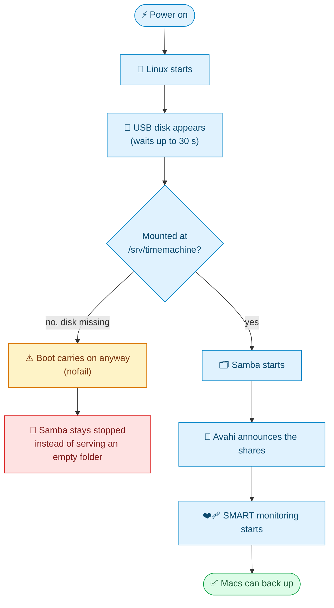
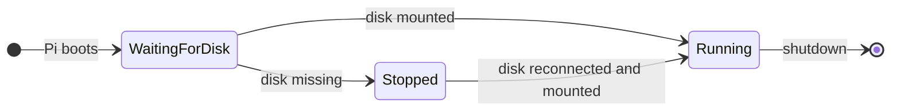

<p align="center"><sub><a href="05-connect-your-macs.md">← Previous</a> &nbsp;·&nbsp; 🏠 <a href="../README.md">Home</a> &nbsp;·&nbsp; <b>Chapter 6 of 9</b> &nbsp;·&nbsp; ▰▰▰▰▰▰▱▱▱ &nbsp;·&nbsp; <a href="07-performance.md">Next: Speed →</a></sub></p>

# 🛡️ 6. Make it survive reboots

A backup server has to come back by itself after a power cut. This chapter covers what has to happen at boot, and how to prove that it does.

**The easy way:** `sudo ./scripts/04-harden.sh`. Below is what it does.

## 🥾 6.1 What must happen at boot



| | What has to happen | Setting that does it |
|---|---|---|
| 1️⃣ | The disk is found and mounted | `fstab` line with `nofail` and a 30 second timeout |
| 2️⃣ | **Then** Samba starts, so it never shares an empty folder | a systemd `RequiresMountsFor` drop-in |
| 3️⃣ | Avahi starts, so Macs can find the share | `systemctl enable avahi-daemon` |
| 4️⃣ | SMART monitoring starts, so a failing disk gets noticed | `systemctl enable smartmontools` |

### 🔌 Mount that can't block the boot

The `fstab` line from [chapter 3](03-prepare-the-drive.md) has two options for this:

```
UUID=<uuid> /srv/timemachine ext4 defaults,noatime,nofail,x-systemd.device-timeout=30 0 2
```

`nofail` means a missing or dead disk doesn't stop the Pi booting, and `x-systemd.device-timeout=30` limits the wait to 30 seconds.

> [!WARNING]
> Without `nofail`, a disconnected USB cable could leave the Pi stuck in emergency mode, unreachable over SSH.

### ⏳ Samba waits for the disk

A systemd drop-in adds one dependency to Samba:

```bash
sudo mkdir -p /etc/systemd/system/smbd.service.d
sudo tee /etc/systemd/system/smbd.service.d/wait-for-drive.conf <<'EOF'
[Unit]
RequiresMountsFor=/srv/timemachine
EOF
sudo systemctl daemon-reload
```

`RequiresMountsFor` makes Samba start only after `/srv/timemachine` is mounted.



> [!NOTE]
> If the disk fails to mount, Samba stays stopped instead of serving an empty folder. An empty folder would make a Mac think its backup was gone and start a new one.

### ▶️ Enable at boot

```bash
sudo systemctl enable smbd avahi-daemon smartmontools
```

## ❤️‍🩹 6.2 Watch the disk's health

Hard drives usually warn before they fail. `smartd` reads the drive's own health counters and logs problems.

For a drive in a USB enclosure, `smartd` needs to be told how to talk to it, or it fails to start with `exit status 17`. Most USB-to-SATA bridges need `-d sat`. Replace the contents of `/etc/smartd.conf` with:

```
/dev/sda -d sat -a -n standby,q -s (S/../.././03|L/../../7/04)
```

| Part | Meaning |
|---|---|
| `-d sat` | Talk to the drive through a USB-to-SATA bridge. |
| `-a` | Monitor all health attributes. |
| `-n standby,q` | Don't wake a sleeping drive for a check, and stay quiet about it. |
| `-s (S/../.././03\|L/../../7/04)` | A short self-test every day at 03:00 and a long one every Sunday at 04:00. |

Keep the original: `sudo cp -n /etc/smartd.conf /etc/smartd.conf.orig`. Then:

```bash
sudo systemctl enable --now smartmontools
systemctl is-active smartmontools
```

### 🔬 Read the numbers yourself

```bash
sudo smartctl -d sat -H /dev/sda                    # overall verdict: PASSED or FAILED
sudo smartctl -d sat -A /dev/sda | grep -E 'Reallocated_Sector|Current_Pending|Offline_Uncorrectable|Power_On_Hours|Temperature'
```

| | Attribute | Healthy value | Why it matters |
|---|---|---|---|
| 🟢 | `Reallocated_Sector_Ct` | 0 | Sectors the drive had to give up on. Rising numbers mean a dying disk. |
| 🟢 | `Current_Pending_Sector` | 0 | Sectors waiting to be reallocated. |
| 🟢 | `Offline_Uncorrectable` | 0 | Sectors the drive could not read at all. |
| ℹ️ | `Power_On_Hours` | information only | Our example disk had 41,250 (4.7 years) and was still healthy. |
| 🌡️ | `Temperature_Celsius` | under about 45 | Ours ran at 34 °C. |

> [!IMPORTANT]
> Replace the disk when any of the first three stop being zero.

## 🧪 6.3 Prove it: the reboot test

Don't trust it until you've seen it.

> [!WARNING]
> **Only do this when no backup is running.** A reboot stops any running backup.

- [ ] Check that nothing is connected: `sudo smbstatus -b`
- [ ] Reboot: `sudo reboot`
- [ ] Wait a minute or two, SSH back in, and run `sudo ./scripts/verify.sh`
- [ ] Every line says `PASS`. In particular, `/srv/timemachine` is mounted, `smbd` and `avahi-daemon` are running, and no systemd unit has failed
- [ ] On a Mac, open Time Machine settings. The share is still selectable, and the next backup runs on its own

Then try the failure case once: **power the Pi off, unplug the USB drive, power it on.** It should boot, SSH should work, and `smbd` should be stopped. Plug the drive back in and run `sudo reboot` to restore normal service.

## 🔄 6.4 Updates

Install updates now and then, but not in the middle of a backup:

```bash
sudo apt-get update && sudo apt-get -y full-upgrade
sudo ./scripts/verify.sh
```

`verify.sh` checks the Samba version, so a Debian update that breaks Time Machine shows up straight away.

---

<p align="center"><sub><a href="05-connect-your-macs.md">← Previous</a> &nbsp;·&nbsp; 🏠 <a href="../README.md">Home</a> &nbsp;·&nbsp; <b>Chapter 6 of 9</b> &nbsp;·&nbsp; <a href="07-performance.md">Next: Speed →</a></sub></p>
