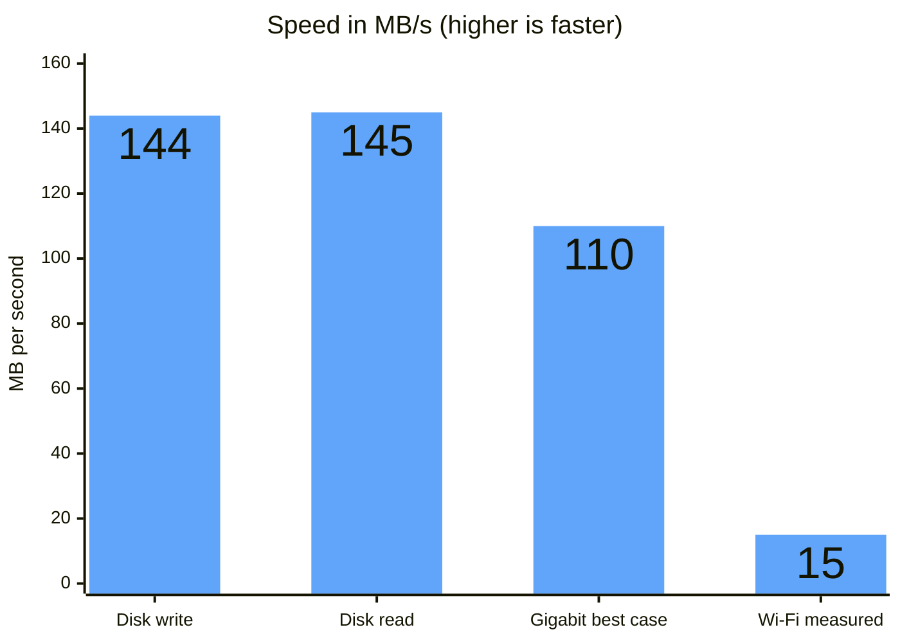
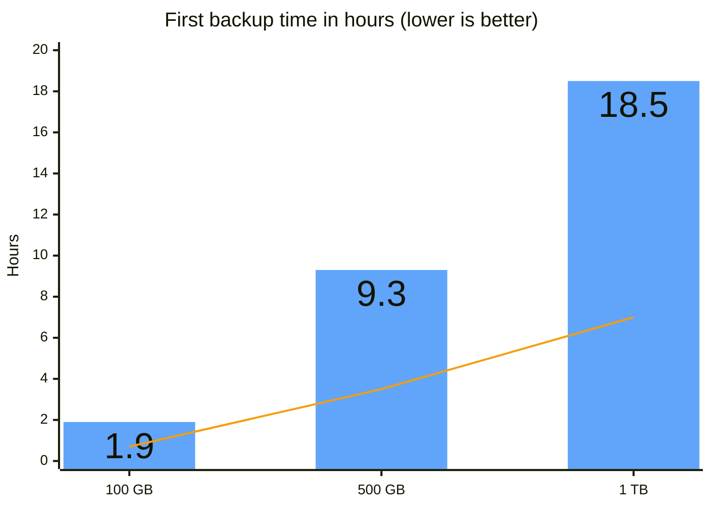
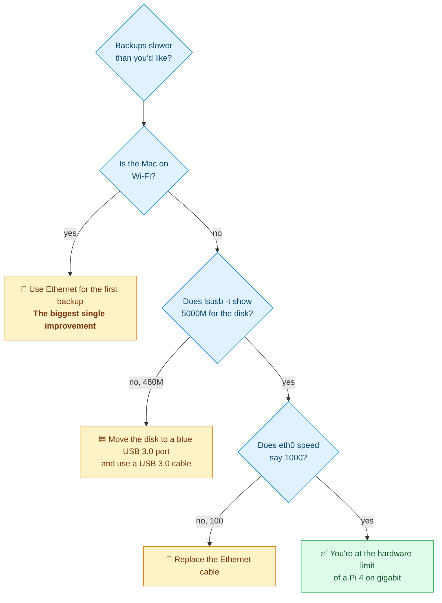

<p align="center"><sub><a href="06-persistence-and-hardening.md">← Previous</a> &nbsp;·&nbsp; 🏠 <a href="../README.md">Home</a> &nbsp;·&nbsp; <b>Chapter 7 of 9</b> &nbsp;·&nbsp; ▰▰▰▰▰▰▰▱▱ &nbsp;·&nbsp; <a href="08-troubleshooting.md">Next: Troubleshooting →</a></sub></p>

# 🚀 7. Speed

Three things limit speed: the **disk**, the **Pi's network port**, and your **Mac's connection** (Wi-Fi or wired).

## 🏁 7.1 Where the bottleneck is

Data from the Mac passes through four links. The slowest one sets the speed.


On Wi-Fi, **the Wi-Fi is the bottleneck**. On Ethernet, the Pi's gigabit port (about 110 MB/s) is just below the disk's speed, so the **network is still the limit, not the disk**.

## 📏 7.2 What we measured

On a Raspberry Pi 4 with a USB 3.0 WD Red 2 TB (5400 RPM) on the blue USB port:



| | Test | Result |
|---|---|---|
| 💾 | Disk, sequential write | **144 MB/s** |
| 💾 | Disk, sequential read | **145 MB/s** |
| 🔌 | Gigabit Ethernet, best case | about 110 MB/s (a hardware limit, not measured) |
| 📶 | A real first backup over Wi-Fi (30-second sample) | **about 15 MB/s** |

The disk tests were run with `scripts/benchmark.sh`, which uses `dd` with direct I/O and a 2 GB file. The Wi-Fi figure was one short sample during the first backup and will vary a lot.

> [!NOTE]
> These are estimates for planning, not guarantees, apart from the measurements above. Time Machine is slower than a plain file copy because it sends many small files and has the sparsebundle overhead on top.

| Connection from the Mac | Best case | Typical Time Machine |
|---|---|---|
| 🔌 Wired gigabit | about 100 MB/s | roughly 30 to 60 MB/s |
| 📶 Wi-Fi | about 25 to 60 MB/s | often 10 to 30 MB/s |

## ⏳ 7.3 How long a first backup takes



The bars are for 15 MB/s (slow Wi-Fi). The line is for 40 MB/s (a good wired connection).

| Data on the Mac | At 15 MB/s | At 40 MB/s |
|---|---|---|
| 100 GB | 1.9 hours | 42 minutes |
| 500 GB | 9.3 hours | 3.5 hours |
| 1 TB | 18.5 hours | 7 hours |

Later backups are incremental and usually take a minute or two.

## 🔬 7.4 Measure yours

**The disk:**

```bash
sudo ./scripts/benchmark.sh
```

**The network between a Mac and the Pi:**

```bash
# on the Pi
sudo apt-get install -y iperf3
iperf3 -s

# on the Mac (install with: brew install iperf3)
iperf3 -c <pi-address>
```

`iperf3` reports the link speed in Mbit/s. Divide by 8 for MB/s. About 940 Mbit/s is the best a gigabit link does.

**The backup itself, while it runs:**

```bash
a=$(sudo du -sb /srv/timemachine/personal | cut -f1); sleep 30
b=$(sudo du -sb /srv/timemachine/personal | cut -f1)
echo "$(( (b-a)/30/1048576 )) MB/s"
```

## 🏎️ 7.5 Making it faster



1. **Use Ethernet on the Mac** for the first backup. It is the biggest single improvement.
2. **Check the disk is on a USB 3.0 port** with `lsusb -t`. `5000M` is right. `480M` is USB 2.0 and would cap you at about 35 MB/s.
3. **Check the Pi's link speed:** `cat /sys/class/net/eth0/speed` should print `1000`. A value of `100` points to a bad cable.
4. **Keep the Mac close to the router** if you must use Wi-Fi, and prefer the 5 GHz band.
5. **A Raspberry Pi 5**, or any faster computer, won't help much on gigabit Ethernet. It only matters if you also add a faster network.

---

<p align="center"><sub><a href="06-persistence-and-hardening.md">← Previous</a> &nbsp;·&nbsp; 🏠 <a href="../README.md">Home</a> &nbsp;·&nbsp; <b>Chapter 7 of 9</b> &nbsp;·&nbsp; <a href="08-troubleshooting.md">Next: Troubleshooting →</a></sub></p>
