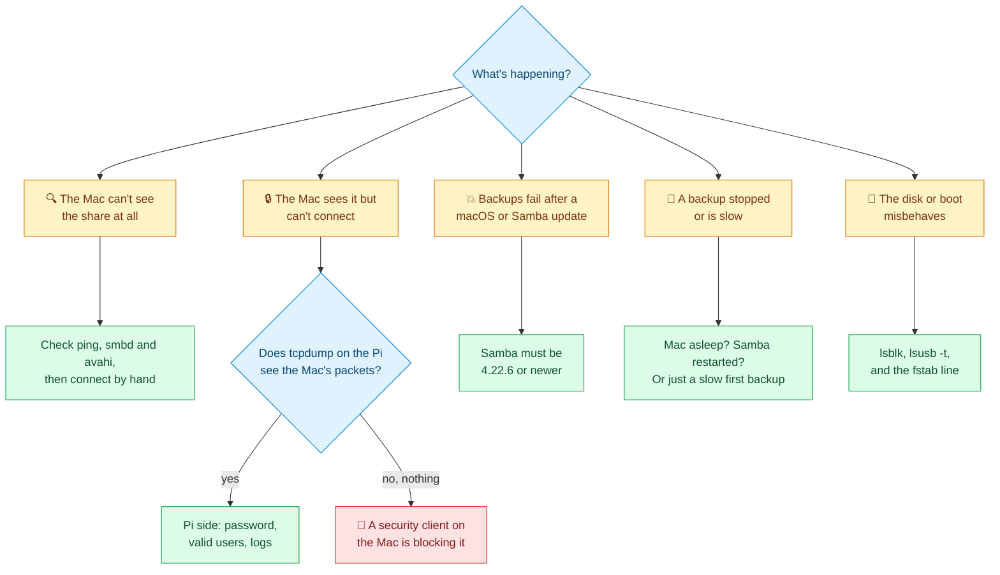
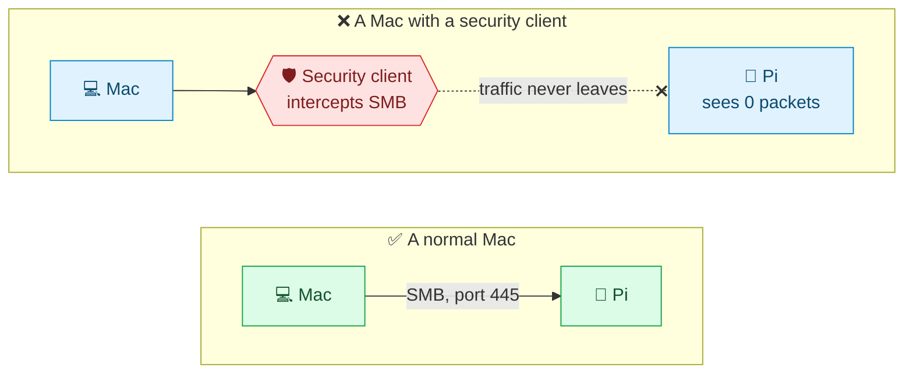
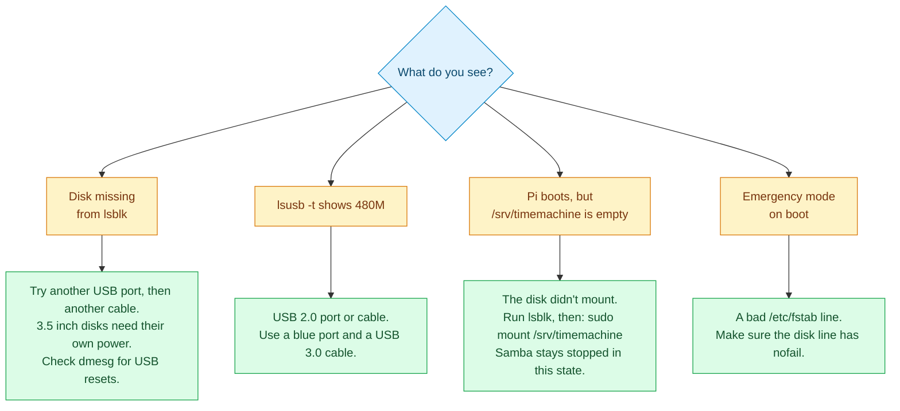

<p align="center"><sub><a href="07-performance.md">← Previous</a> &nbsp;·&nbsp; 🏠 <a href="../README.md">Home</a> &nbsp;·&nbsp; <b>Chapter 8 of 9</b> &nbsp;·&nbsp; ▰▰▰▰▰▰▰▰▱ &nbsp;·&nbsp; <a href="09-maintenance.md">Next: Maintenance →</a></sub></p>

# 🩺 8. Troubleshooting

> [!TIP]
> **Start here:** run `sudo ./scripts/verify.sh` on the Pi. It checks the disk, services, Samba version, users, shares and Bonjour, and names the thing that's wrong.

## 🧭 Find your problem



| | Jump to |
|---|---|
| 🔍 | [The Mac can't see the share](#cant-see) |
| 🔒 | [The Mac sees it but can't connect](#cant-connect) |
| 💼 | [Managed work laptops](#managed-laptops) |
| 💥 | [Backups fail after updating macOS or Samba](#samba-bug) |
| 🐢 | [A backup stopped or is slow](#slow) |
| 💾 | [Disk and boot problems](#disk-boot) |
| 🙈 | [Messages that look scary but aren't](#scary) |

---

<a id="cant-see"></a>

## 🔍 The Mac can't see the share

1. Is the Pi on and reachable? `ping <pi-hostname>.local` or `ping <pi-address>`.
2. On the Pi: `systemctl is-active smbd avahi-daemon`. Both must say `active`.
3. Is the share listed? `testparm -s | grep '^\['`. It should show `TimeMachine-<Name>`.
4. Is it announced? `grep adVN /etc/avahi/services/timemachine.service` should list each share.
5. Connect by hand to rule out Bonjour: Finder → Go → Connect to Server → `smb://<pi-address>/TimeMachine-<Name>`. If this works, only the announcement is the problem. Restart Avahi with `sudo systemctl restart avahi-daemon`.

<a id="cant-connect"></a>

## 🔒 The Mac sees the share but can't connect

First, find out whether the Mac's traffic reaches the Pi at all. This is the most useful test in this chapter. It separates "the Pi is refusing" from "something on the Mac is stopping it".

**On the Pi**, start a capture:

```bash
sudo timeout 120 tcpdump -n -i eth0 'tcp port 445'
```

**On the Mac**, now try to connect from Finder (⌘K → `smb://<pi-address>/TimeMachine-<Name>`). Then read the capture:

| Capture shows | Meaning |
|---|---|
| ✅ Packets from the Mac's address | The traffic arrives. The problem is on the Pi: check the password (`sudo smbpasswd <name>`), `valid users`, and `/var/log/samba/`. |
| ❌ **Nothing at all** | The traffic never left the Mac. Something on the Mac is blocking or redirecting it. See [managed laptops](#managed-laptops). |

Other causes, in order of likelihood:

- 🔑 **Wrong login.** Each share only accepts its own user. The user for `TimeMachine-Work` is `work`, not your Mac username.
- 🏷️ **Name lookup fails.** `.local` names rely on Bonjour. Use the IP address instead. If that works, name lookup is the problem.
- 🔐 **Password never set.** `sudo pdbedit -L` should list each user. If one is missing, run `sudo smbpasswd -a <name>`.

<a id="managed-laptops"></a>

## 💼 Managed work laptops and VPN clients

A work laptop with a security client such as **Zscaler**, a corporate VPN, or an endpoint-protection agent often routes or blocks traffic to devices on your home network, including SMB on port 445. Typical symptoms:

- The Mac **lists** the share (Bonjour is local and still works) but **cannot connect**, by name or by IP.
- Finder says "There was a problem connecting to the server".
- The Pi's logs and `tcpdump` show **no packets** from the laptop.



### 🪤 A trap: the port test that lies

This command can report success even when the connection never leaves the Mac:

```bash
nc -vz -G 5 <pi-address> 445
# Connection to <pi-address> port 445 succeeded!
```

Some security clients accept the connection locally and then drop it. A passing `nc` test proves nothing. Trust the `tcpdump` result from the Pi instead.

### 🧑‍⚖️ What to do

1. **Check your employer's policy first.** Backing up a work computer to personal hardware may not be allowed, because the backup then holds company data on a disk you own. Ask your IT or security team.
2. **If it is allowed,** ask IT to exclude your home network (for example `192.168.1.0/24`, or just the Pi's address) from the tunnel for SMB (port 445). They may call it a local-network exclusion or a bypass.
3. **If it isn't allowed,** use the backup tool your employer provides.

> [!CAUTION]
> Don't try to switch off or work around the security client on a managed machine. It can breach your employer's policy and trigger security alerts.

If you don't need a share for that laptop, remove it with `sudo ./scripts/remove-mac.sh <name>`.

<a id="samba-bug"></a>

## 💥 Backups fail after updating macOS or Samba

**The Samba bug.** Samba 4.21 and the early 4.22 releases (before 4.22.6) have a regression that breaks Time Machine on macOS 26 (Tahoe). The usual symptom is a failed backup with `BACKUP_FAILED_DISCONNECTED_DISK_IMAGE` or "the backup disk image couldn't be accessed".

| Samba version | macOS 26 Time Machine |
|---|---|
| 4.20 and older | 🟢 works |
| 4.21.x | 🔴 broken |
| 4.22.0 to 4.22.5 | 🔴 broken |
| **4.22.6 and newer** | 🟢 works |

Check the version and fix it by updating:

```bash
smbd --version
sudo apt-get update && sudo apt-get install --only-upgrade samba
```

Debian 13 ships 4.22.11. `verify.sh` fails with a clear message on an affected version.

**If you can't update Samba yet,** there is a temporary workaround on the Mac. Copy [`config/mac/nsmb.conf`](../config/mac/nsmb.conf) to `/etc/nsmb.conf` (needs `sudo`), then try the backup again.

> [!WARNING]
> Delete `/etc/nsmb.conf` once Samba is updated. It changes how the Mac signs every SMB connection.

**After a macOS update,** if backups fail, restart the Mac's connection: remove and re-add the backup disk in Time Machine settings (your existing backup is kept), and check `smbd` is running on the Pi.

<a id="slow"></a>

## 🐢 A backup stopped or is slow

| Situation | What's happening |
|---|---|
| 😴 The backup stopped overnight and the Pi shows no connection | The Mac went to sleep. It resumes when the Mac wakes. If it doesn't, click **Back Up Now** in Time Machine settings. |
| 🔁 The backup stopped right after you changed shares | Restarting Samba drops every connection. The Mac reconnects by itself. Click **Back Up Now** if it doesn't. |
| 📂 The folder on the Pi is empty a few minutes into the first backup | Normal. Time Machine is "preparing" and sizing the backup. Wait 5 to 10 minutes. |
| 📶 About 15 MB/s on Wi-Fi | Normal for Wi-Fi. See [chapter 7](07-performance.md) for how to speed it up. |
| 🈵 "The backup disk is full" | Check `df -h /srv/timemachine`. Time Machine deletes old backups itself. If one Mac has used most of the space, set a per-share quota ([chapter 1](01-how-it-works.md)). |

<a id="disk-boot"></a>

## 💾 Disk and boot problems



- 🔌 **The disk doesn't show up in `lsblk`.** Try another USB port, then another cable. A 3.5" disk needs its own power supply. A bus-powered 2.5" disk that keeps disconnecting may need a powered USB hub. Check `dmesg | tail -30` for USB reset messages.
- 🐌 **The disk shows `480M` in `lsusb -t`.** It's on a USB 2.0 port or cable. Use a blue USB 3.0 port on the Pi 4 and a USB 3.0 cable.
- 📭 **The Pi boots but `/srv/timemachine` is empty.** The disk didn't mount. Run `lsblk` and `sudo mount /srv/timemachine`. With the settings in chapter 6, Samba won't start in this state.
- ❤️‍🩹 **`smartmontools` fails to start with `exit status 17`.** `smartd` can't read the disk. For a USB disk, `/etc/smartd.conf` needs `-d sat`. See [chapter 6](06-persistence-and-hardening.md).
- 🚨 **Emergency mode on boot.** Almost always a bad `/etc/fstab` entry. Make sure the disk line has `nofail`. From the emergency prompt, edit `/etc/fstab` to fix or comment out the line.

<a id="scary"></a>

## 🙈 Messages that look scary but aren't

| Message | Verdict |
|---|---|
| `unpack_canon_ace: no security info sent !` or `unpack_nt_owners: no security info sent !` in `/var/log/samba/` | 🟢 A macOS client quirk. Backups are fine. |
| `Error: Timeout was reached` at the end of `apt-get upgrade` | 🟢 A slow SD card, and the packages still installed. Confirm with `sudo dpkg --audit` (prints nothing) and `apt list --upgradable` (empty). |
| `smartctl: Unknown USB bridge` | 🟢 The disk is read through a USB bridge. Add `-d sat`. |
| `pam_unix(samba:session): session opened/closed for user ...` in the journal | 🟢 Normal login and logout of a Mac. |

## 🆘 Still stuck?

Collect this and share it (it contains no passwords):

```bash
sudo ./scripts/verify.sh
smbd --version
testparm -s 2>/dev/null | grep -E '^\[|Loaded'
sudo journalctl -u smbd --since "-1h" --no-pager | tail -30
```

---

<p align="center"><sub><a href="07-performance.md">← Previous</a> &nbsp;·&nbsp; 🏠 <a href="../README.md">Home</a> &nbsp;·&nbsp; <b>Chapter 8 of 9</b> &nbsp;·&nbsp; <a href="09-maintenance.md">Next: Maintenance →</a></sub></p>
