<p align="center"><sub><a href="08-troubleshooting.md">← Previous</a> &nbsp;·&nbsp; 🏠 <a href="../README.md">Home</a> &nbsp;·&nbsp; <b>Chapter 9 of 9</b> &nbsp;·&nbsp; ▰▰▰▰▰▰▰▰▰</sub></p>

# 🧹 9. Maintenance

Once it's running, there is very little to do. This chapter is the short list.

## 📅 What to do, and when

<p align="center"></p>

## 🔎 Everyday checks

```bash
sudo ./scripts/verify.sh                       # everything, read-only
sudo smbstatus -b                              # who is connected
df -h /srv/timemachine                         # free space
sudo du -sh /srv/timemachine/*                 # size per Mac
sudo smartctl -d sat -H /dev/sda               # disk health
```

## ➕ Add another Mac

```bash
sudo ./scripts/add-mac.sh laptop
```

This adds `laptop` to `config.env`, creates the user and folder, writes the share and Bonjour entry, and asks you for the password.

> [!WARNING]
> **It restarts Samba**, which interrupts any backup in progress, so do it between backups. To skip the restart and do it yourself later: `sudo NO_RESTART=1 ./scripts/add-mac.sh laptop`.

Then connect the new Mac as in [chapter 5](05-connect-your-macs.md).

## ➖ Remove a Mac

```bash
sudo ./scripts/remove-mac.sh laptop                  # keeps the backup folder
sudo ./scripts/remove-mac.sh laptop --delete-data    # also deletes its backups
```

The first form removes the login and the share but keeps `/srv/timemachine/laptop`, so you can still copy files out. Delete the folder later to reclaim the space.

> [!CAUTION]
> Don't use `--delete-data` unless you're sure. It can't be undone.

## 🔑 Change a password

```bash
sudo smbpasswd personal
```

Then update the saved password on that Mac in Time Machine settings.

## 🔄 Updates

```bash
sudo apt-get update && sudo apt-get -y full-upgrade
sudo ./scripts/verify.sh
```

Do this between backups. If an update touches Samba, the connection to your Macs drops while it restarts. `verify.sh` tells you immediately if the new Samba version is one that breaks Time Machine.

Reboot when `/var/run/reboot-required` exists:

```bash
ls /var/run/reboot-required 2>/dev/null && echo "reboot needed"
```

## 🈵 When the disk is getting full

Time Machine removes a Mac's oldest backups when space runs low, so a full disk is usually fine. Do something if:

- one Mac keeps crowding out another. Set a quota (`fruit:time machine max size = 900G` in that share, then `sudo systemctl restart smbd`), or
- you want longer history. Move to a bigger disk.

## 🔁 Replace the disk

<p align="center"></p>

Your old backups are on the old disk. Keep it for a while, so you can restore from it if the new disk has problems, then recycle it.

## 🗄️ Back up the server's configuration

Everything about this setup is in this repository and `config.env`. Keep `config.env` somewhere safe. It holds your disk path and user names (no passwords). The Samba passwords live in Samba's own database (`/var/lib/samba/private/passdb.tdb`), so after a reinstall you'll set them again with `smbpasswd -a`.

## 🗑️ Uninstall

<details>
<summary><b>Go back to a plain Pi</b></summary>

Stop and disable the services, remove the share block and the fstab line, and optionally erase the disk:

```bash
sudo systemctl disable --now smbd avahi-daemon smartmontools
sudo rm /etc/avahi/services/timemachine.service /etc/systemd/system/smbd.service.d/wait-for-drive.conf
sudo cp /etc/samba/smb.conf.orig /etc/samba/smb.conf
sudo cp /etc/smartd.conf.orig /etc/smartd.conf
sudo sed -i '\|/srv/timemachine|d' /etc/fstab
sudo umount /srv/timemachine
```

</details>

---

<p align="center"><sub><a href="08-troubleshooting.md">← Previous</a> &nbsp;·&nbsp; 🏠 <a href="../README.md">Home</a> &nbsp;·&nbsp; <b>Chapter 9 of 9</b> &nbsp;·&nbsp; 🎉 You made it. Enjoy your backups.</sub></p>
